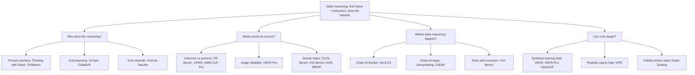

# Video Reasoning — Idea Map

Four questions organize the 26 papers. Representative papers are placed where their main evidence lands.

Timeline used in the deck:

- 2025-09 to 2025-11: zero-shot claims, then the first cracks (papers 1–8).
- 2025-12: same month, opposite conclusions (papers 9–12).
- 2026-02 to 2026-04: training data and mechanism studies (papers 13–17).
- 2026-05 to 2026-07: methods that try to make models reason (papers 18–22).
- 2026-08 to 2026-09: recalibration with stricter benchmarks and controlled studies (papers 23–26).
